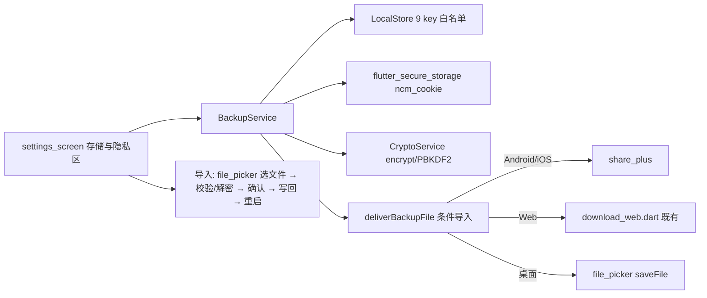

## 产品概述

在 kele-music 设置页「存储与隐私」区块新增「导出备份 / 导入备份」功能：将用户全部本地数据打包为一个备份文件，用于换手机/换设备时一键迁移。

## 核心功能

- **导出备份**：收集全部本地数据（9 个 LocalStore 配置/历史/统计 key + 网易云登录 cookie，用户已确认含 cookie 以实现免登录迁移），生成 `kele-music-backup-日期.json` 文件
- 可选设置密码：不设密码则导出明文 JSON；设密码则 PBKDF2 派生密钥 + AES 加密整个负载
- Android/iOS 弹系统分享面板发送文件；Web 触发浏览器下载；桌面选目录保存
- **导入备份**：选择备份文件 → 校验格式与版本 → 有密码则输入密码解密 → 弹确认框列出将被覆盖的数据项 → 确认后整体覆盖写入本地存储与安全存储
- 错误处理：文件损坏/格式不符/密码错误/版本过新均给出明确提示，不写入任何数据
- **自动重启**：导入成功提示后自动重启应用，使全部模块读到新数据
- 收藏/歌单为云端数据，不参与迁移（界面提示文案中说明）

## 技术栈

- 沿用现有 Flutter（Dart）六端同构架构，不引入新框架
- 新增依赖：`file_picker`（选文件）、`share_plus`（分享面板）、`encrypt`（AES/PBKDF2）、`restart_app`（Android/iOS 重启）
- 复用现有：`path_provider`、`flutter_secure_storage`、LocalStore、`lib/core/download.dart` 条件导入模式

## 实现方案

### 关键决策

1. **备份服务独立成模块** `lib/core/backup/`：与播放、存储等模块解耦，导出/导入各一个门面方法，UI 只调两个入口（SoC，避免塞进 settings_screen）。
2. **白名单导出而非整库快照**：从 `lib/core/constants.dart` 的 9 个 key 白名单逐项收集（排除 `ncm_api_base_url` 之外的运行时杂项风险为 0，未来新 key 可加白名单常量），再从 secure storage 读 `ncm_cookie`。key 常量收拢到备份模块内一份 `kBackupKeys` 列表，并引用 constants.dart 现有常量，避免硬编码字符串。
3. **加密格式自描述**：文件顶层 `{magic, formatVersion, createdAt, appVersion, encrypted, payload}`；`payload` 在 encrypted=true 时为 `{salt, iv, ciphertext}`（Base64），否则为原始数据 Map。导入按 `formatVersion` 判断兼容性，未来升级可留迁移钩子（YAGNI：当前仅 v1）。
4. **平台差异收敛到条件导入**：仿照现有 `download.dart`（web/io 条件导出）模式新建 `backup_share.dart` / `backup_share_web.dart` / `backup_share_io.dart`，统一 `deliverBackupFile(name, bytes)` 接口；Web 端直接复用既有 `downloadFile()`；Android/iOS 走 share_plus（需先把 bytes 落临时文件）；桌面用 file_picker 的 saveFile。
5. **覆盖式导入 + 全量写回**：确认后按白名单逐 key `setXxx` 写回 LocalStore（自动覆盖旧值），cookie 用 secure storage write；文件中缺失的 key 保持本地现状（只覆盖文件里有的项，安全降级）。
6. **导入后自动重启**：Android/iOS 用 restart_app；Web 用 `window.location.reload()`；桌面提示手动重启（restart_app 不支持桌面端）。此为唯一可靠生效方式——各 Notifier 仅构造时 `_load()`，热刷新状态残留风险高，用户已确认此策略。

### 备份文件格式

```
{
  "magic": "kele-music-backup",
  "formatVersion": 1,
  "createdAt": "2026-11-02T10:00:00",
  "appVersion": "1.x.x",
  "encrypted": false,
  "payload": { "keys": { "ncm_style_index": 1, "...": "" }, "ncm_cookie": "..." }
}
```

### 架构



### 目录结构

```
lib/
├── core/
│   └── backup/
│       ├── backup_service.dart        # [NEW] 导出/导入核心：白名单收集、格式校验、解密、写回
│       ├── backup_crypto.dart         # [NEW] PBKDF2+AES-GCM 加解密封装（encrypt 包）
│       ├── backup_share.dart          # [NEW] deliverBackupFile 平台条件导入桩
│       ├── backup_share_web.dart      # [NEW] Web 实现：复用 download.dart 触发浏览器下载
│       └── backup_share_io.dart       # [NEW] IO 实现：临时文件落盘 + share_plus / saveFile
├── features/settings/
│   └── settings_screen.dart           # [MODIFY] 「存储与隐私」区块末尾加「导出备份」「导入备份」两个 tile + 密码弹窗/确认框/结果提示
└── pubspec.yaml                       # [MODIFY] 新增 share_plus、file_picker、encrypt、restart_app
```

### 执行要点

- 所有读写复用 LocalStore 同步 API，导出为一次性 O(n) 序列化，统计数据 JSON 已是字符串直接透传，无性能热点
- 失败原子性：导入先在内存完成解析+解密+校验，全部成功后才落盘写回，任何一步失败即中止且不动本地数据
- 密码弹窗与确认框沿用设置页现有弹层/`_ActionTile` 风格，不引入新 UI 模式
- cookie 属敏感数据：不写日志；解密失败提示「密码错误或文件已损坏」

## Agent Extensions

### Skill

- **playwright-cli**
- Purpose: Web 端构建后用浏览器实测导出下载、导入覆盖、错误密码/损坏文件等场景
- Expected outcome: 截图与操作日志证明导出/导入全流程在 Web 端可用

### SubAgent

- **code-explorer**
- Purpose: 实现前复核 providers.dart 各 Notifier 的 key 读写方式与 download.dart 条件导入签名，确保备份模块 API 对齐
- Expected outcome: 拿到精确的方法签名与常量名清单，避免实现时猜接口