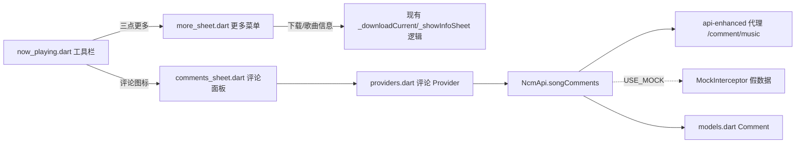

## Product Overview

在播放页（正在播放）新增「查看歌曲评论」能力：工具栏入口、玻璃拟态评论面板（热门/最新双 Tab、加载更多），并将原「下载」入口收纳进「更多」菜单。

## Core Features

- 工具栏调整：「歌曲信息」图标（info）替换为「评论」图标，点击弹出评论面板；「下载」图标替换为纵向三点「更多」图标，弹窗内含「下载」与「查看歌曲信息」两项（复用现有 _downloadCurrent / _showInfoSheet 逻辑）。
- 评论面板：玻璃拟态底部抽屉风格（与定时停止/歌曲信息弹窗一致），顶部展示歌曲名与评论总数，「热门」「最新」双 Tab 各自独立分页。
- 评论条目：头像、昵称、内容、时间、点赞数；无评论/加载失败有对应空态与错误态；滚动到底自动/点击加载更多。
- 数据来源：真实网易云 /comment/music（api-enhanced 代理），只读浏览，不支持点赞/回复。
- Mock 兼容：USE_MOCK 模式下返回同构假评论数据，离线可演示。
- 边界：本地歌曲（负数 id）不请求评论，面板内提示「本地歌曲暂不支持评论」。

## Tech Stack

- Flutter 3.16+ / flutter_riverpod ^2.4.9 / dio ^5.4.0（沿用现有依赖，不新增包）。
- 沿用现有分层：data 模型+API 客户端 → providers 状态 → features/player UI。

## Implementation Approach

- 数据层：models.dart 新增 Comment 模型（手写 fromJson，字段容错：user.avatarUrl/nickname、content、time、likedCount、replyCount，应对缺失/类型不一致）；api_client.dart 新增 songComments(id, {tab, limit, offset}) 方法，解析 total/hotComments/comments/more/moreHot，评论走边缘缓存（不加 bustCache）。
- 状态层：providers.dart 新增评论 Provider 家族（按 songId + tab 管理列表/分页/加载态，切歌或面板关闭后失效，避免脏数据与重复请求）。
- UI 层：新建 lib/features/player/comments_sheet.dart（评论面板）与 more_sheet.dart（更多菜单），全部复用 AppStyle tokens 与现有玻璃拟态配方（Color.alphaBlend(style.surface, 0x8C000000) + BackdropFilter blur 24 + surfaceBorder + uiRadius+8 + maxWidth 420 限宽）；now_playing.dart 仅做工具栏图标替换与弹窗调用接线，不改动播放核心逻辑。
- Mock 层：mock_interceptor.dart 按 path 前缀匹配 /comment/music，生成同构假数据（含 hotComments/comments/total/more 字段，固定头像用占位图），保持与真实接口形状一致。

### Architecture

## Implementation Notes

- 评论请求防重入：同一 (songId, tab, offset) 在加载中不重复发起；切歌后立即失效旧状态，避免串台。
- 列表用 ListView.builder 惰性构建，长列表无性能隐患；加载更多触发点放在列表尾部（滚动近底或底部按钮）。
- /comment/music 不可用或 code 异常时按现有 ApiException.userMessage 展示错误态 + 重试，不中断播放页。
- 爆炸半径控制：不改动 NcmApi 既有方法与拦截器顺序；now_playing.dart 仅替换两个 IconButton 与新增两个 showModalBottomSheet 调用。

## Design Style

沿用播放页既有「深色玻璃拟态」体系，不引入新视觉语言：评论面板与更多菜单均为底部抽屉，深色玻璃底（surface 叠 35% 黑）+ 24px 背景模糊 + 细描边 + 大圆角，宽屏限宽 420 居中。

## Panel Layout

- 评论面板：把手 + 标题行（「评论」+ 总数徽标）+ 热门/最新 Tab（accent 高亮下划线）+ 可滚动评论列表 + 底部加载更多状态。
- 评论条目：36px 圆形头像（SafeNetworkImage，失败回退占位）、昵称（次级色小字）、正文（主色 13.5px）、底部行（相对时间 + 点赞数 icon），条目间细分隔线。
- 更多菜单：与 song_actions 面板同构的图标+文字行列表（下载 / 查看歌曲信息），InkWell 圆角水波纹。

## Interaction

Tab 切换淡入过渡；加载更多显示底部小 spinner；空态/错误态居中图标+文案+重试按钮；面板弹出时播放页不受影响。