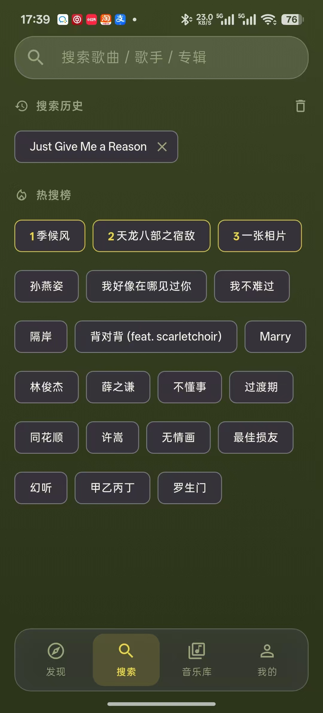
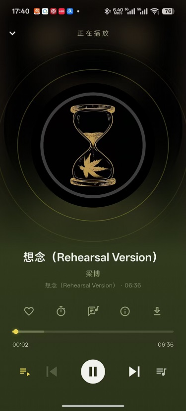
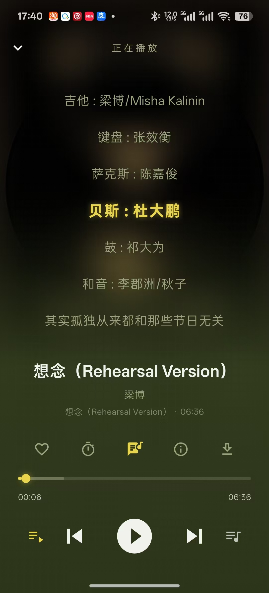
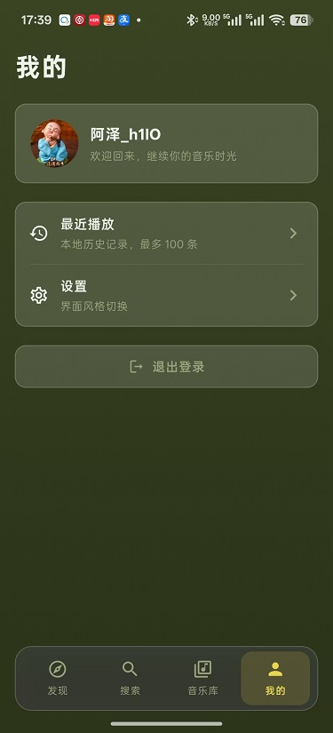
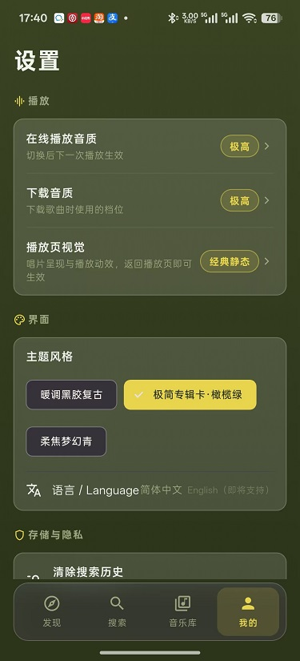

# 在线音乐客户端（kele-music 可乐音乐）

基于开源 [api-enhanced](https://github.com/NeteaseCloudMusicApiEnhanced/api-enhanced)（其上游为 [Binaryify/NeteaseCloudMusicApi](https://github.com/Binaryify/NeteaseCloudMusicApi)）的第三方在线音乐客户端。
**一套 Flutter 代码同时构建 Android / iOS / macOS / Windows / Linux / Web 六端。**

> 当前版本 v1.1.0：登录 + 发现 / 搜索 / 音乐库 / 播放 / 设置完整链路。功能清单见下方「功能特性」，版本演进见 [`docs/release-notes.md`](docs/release-notes.md)。

## 功能特性

- **发现**：编辑精选歌单、每日推荐、私人雷达、新歌速递、排行榜
- **搜索**：歌曲 / 歌手 / 专辑搜索，搜索历史与热搜榜
- **音乐库**：创建歌单 / 收藏歌单，收藏歌单一键管理
- **播放**：全屏播放页（黑胶唱片 / 经典静态等多种视觉），逐行歌词（含演唱人员信息），睡眠定时、喜欢、下载
- **后台播放**：audio_service 支持后台播放与锁屏 / 通知栏媒体控制
- **我的**：本地最近播放历史（最多 100 条）、账号信息、退出登录
- **设置**：在线播放音质、下载音质、播放页视觉切换、三套主题风格（暖调黑胶复古 / 极简专辑卡·橄榄绿 / 柔焦梦幻青）、多语言（英文支持即将上线）、清除搜索历史、检查更新
- **检查更新**：设置 → 关于 → 检查更新，读取 GitHub Releases 最新版本；Android 应用内下载 APK 并拉起系统安装（可取消、不强制），下载走国内镜像加速并按 GitHub digest 做 SHA-256 完整性校验，其余平台展示更新说明并跳转 Release 页
- **跨平台**：一套代码构建 Android / iOS / macOS / Windows / Linux / Web 六端

## 待完成功能

- [ ] 播放本地音乐
- [ ] 播放时长统计

## 下载

预编译安装包统一发布在 GitHub Releases（各平台产物 + 安装说明）：

👉 **[Releases · 51www/kele-music](https://github.com/51www/kele-music/releases)**

| 平台 | 产物 | 备注 |
|---|---|---|
| Android | `*-android-universal.apk` | 通用包，手机直接安装；另有分 ABI 包与 `.aab` |
| Windows | `*-windows-x64.zip` | 免安装，解压即用 |
| macOS | `*-macos-arm64.zip` / `*-macos-x64.zip` | Apple Silicon / Intel |
| Linux | `*-linux-x64.tar.gz` | 需 `libsecret` / `libmpv2` |
| iOS | `*-ios-unsigned.app.zip` | 未签名，需自行签名或侧载 |
| Web | `*-web.zip` | 静态站点（canvaskit 自托管，离线可用） |

安装细则见 [`docs/release-notes.md`](docs/release-notes.md)。

## 致谢 Acknowledgements

本项目站在以下开源项目的肩膀上，在此一并致以谢意 🤝：

- **后端基石 · [NeteaseCloudMusicApi](https://github.com/Binaryify/NeteaseCloudMusicApi)**（Binaryify，MIT）
  在线音乐服务第三方接口规范的源头项目，逆向并整理了完整的 `weapi/eapi` 接口约定。本项目所用网关正是它的衍生版本，没有这套接口约定就没有这个客户端。
- **项目后端 · [api-enhanced](https://github.com/NeteaseCloudMusicApiEnhanced/api-enhanced)**（NeteaseCloudMusicApiEnhanced，MIT）
  在 Binaryify 原版基础上持续维护与增强（解灰 / 多音源 / 无损 / Docker 一键部署等），本项目自托管网关即基于此。感谢社区志愿者长期无偿维护。
- **UI 设计参考 · 官方播放页**
  三套可切换主题（`vinyl-sunset` / `bold-olive` / `soft-teal`）的配色、版式与质感，提炼自官方播放页参考图，设计推导见 `docs/ui-style-prompts.md`。
- **依赖生态 · Flutter / Dart 开源包**
  应用得以顺畅运转，离不开这些高质量开源依赖的维护者们：`flutter_riverpod`（状态管理）、`go_router`（路由 + 登录守卫）、`dio`（网络层）、`audio_service` + `just_audio`（后台播放 / 锁屏媒体控制）、`flutter_secure_storage`（登录态安全存储）、`shared_preferences`、`cached_network_image`、`path_provider`、`cupertino_icons`。向所有贡献者致敬。

### 同类优秀开源项目（架构 / 设计参考，非直接依赖）

方案设计阶段，以下同类客户端提供了不少灵感与对照（本项目并未直接 fork 其代码）：

- [boyan01/flutter-netease-music](https://github.com/boyan01/flutter-netease-music) — 经典的 Flutter 第三方音乐客户端，交互细节参考很多。
- [xiaoai7904/netease_cloud_music_app](https://github.com/xiaoai7904/netease_cloud_music_app) — 入门级 Flutter 实战，结构清晰易读。
- 以及众多基于 [NeteaseCloudMusicApi](https://github.com/Binaryify/NeteaseCloudMusicApi) 生态的 Web / 桌面客户端，共同推动了第三方在线音乐客户端生态的繁荣。

## 免责声明

本项目为**个人学习 / 非商业**用途的第三方客户端，仅供技术研究与交流：

- 所有音乐内容、封面与歌词版权均归原作者及相关权利方所有，本项目不存储、不提供任何受版权保护的音频资源。
- 播放依赖第三方开源网关（api-enhanced），所得数据均来自公开接口；使用者须自行遵守所在地区的法律法规与服务条款。
- 本项目与网易云音乐（NetEase）无任何官方关联，亦未获得其授权或背书；软件按「现状」提供，作者不对使用过程中产生的任何后果负责。
- 请勿将本项目用于任何商业或侵权用途。

## 技术栈
- Flutter 3.x + Dart 3.x
- 状态管理：flutter_riverpod
- 路由：go_router（带登录守卫）
- 网络：dio（封装在 `lib/data/api_client.dart`）
- 播放：audio_service + just_audio（后台播放 / 锁屏媒体控制）
- 本地存储：flutter_secure_storage（cookie）+ shared_preferences（风格偏好）

## 快速开始
```bash
# 1) 新开一个终端（让 PATH 生效），确认版本
flutter --version          # 应输出 Flutter 3.47.7 • Dart 3.13.5

# 2) 安装依赖（见下方「排错」：大陆网络需切中国镜像 + 临时关代理）
flutter pub get

# 3) 运行（按需选择目标）
.\run_web.bat              # Web（推荐：已内置本地 canvaskit，避免 gstatic 被墙白屏）
flutter run                # 默认设备（Android / 桌面）
flutter run -d macos       # macOS 桌面（需在一台 Mac 上构建） 
# 推荐：一键启动（已含本地 canvaskit 参数）
.\run_web.bat
# 或等价手动命令
flutter run -d chrome --dart-define=FLUTTER_WEB_CANVASKIT_URL=/canvaskit/
# 生产构建
flutter build web --dart-define=FLUTTER_WEB_CANVASKIT_URL=/canvaskit/
```
 

## 关键配置
- 后端地址：`lib/core/constants.dart` 中的 `kBaseUrl`（当前为 `https://music.2000321.xyz`）。
- 运行时配置：`assets/config/app_config.json`（**不入库**，可能含密钥）。新克隆需先创建，否则构建会因缺资产而失败：
  ```bash
  cp assets/config/app_config.example.json assets/config/app_config.json
  ```
  键位说明见 [`docs/api-config.md`](docs/api-config.md)。
- 三套可切换风格：定义在 `lib/core/styles.dart`，与 `docs/ui-styles.json` 一一对应；在「设置」页切换并持久化。
- 风格视觉参考与提示词：`docs/ui-style-prompts.md`。

 

本地单平台打包（需对应平台工具链）：
```bash
flutter build apk --release            # Android
flutter build appbundle --release      # Android AAB
flutter build windows --release        # Windows（需 VS C++ 桌面开发）
flutter build macos --release          # macOS（需在 Mac 上）
flutter build linux --release          # Linux（需 GTK3 dev）
flutter build ios --release --no-codesign   # iOS（需在 Mac 上）
# Web 必须带 canvaskit 自托管参数，否则会去访问被墙的 gstatic
flutter build web --release --dart-define=FLUTTER_WEB_CANVASKIT_URL=/canvaskit/
```

> 调试登录态可临时注入真实 cookie（敏感信息不入库）：
> `flutter run --dart-define=DEV_COOKIE="<MUSIC_U=...; __csrf=...>"`

## 项目截图

> 以下为 Android 端实机截图（橄榄绿主题），完整截图见仓库 `docs/screenshots/` 目录。

### 发现 / 搜索

| 发现页（每日推荐 / 私人雷达） | 搜索（历史 + 热搜榜） |
|---|---|
|  |  |

### 播放 / 歌词

| 全屏播放页（黑胶版式） | 歌词页（含演唱人员） |
|---|---|
|  |  |

### 音乐库 / 我的

| 音乐库（收藏歌单） | 我的 |
|---|---|
|  |  |

### 设置

| 设置（音质 / 主题风格 / 语言） |
|---|
|  |

 